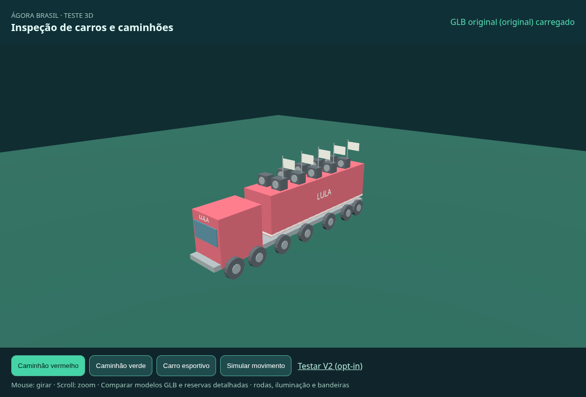
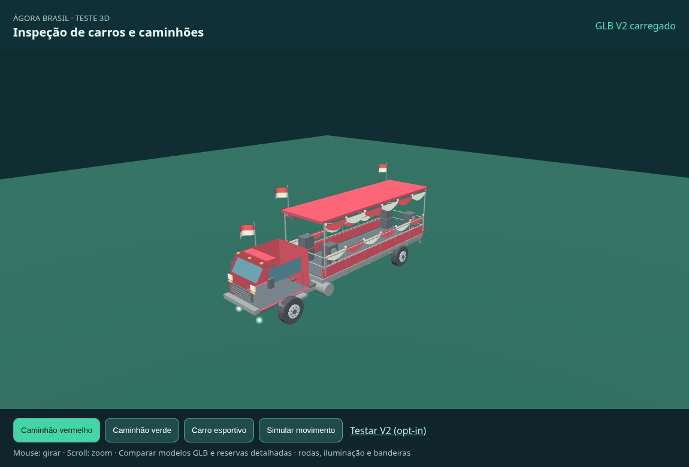
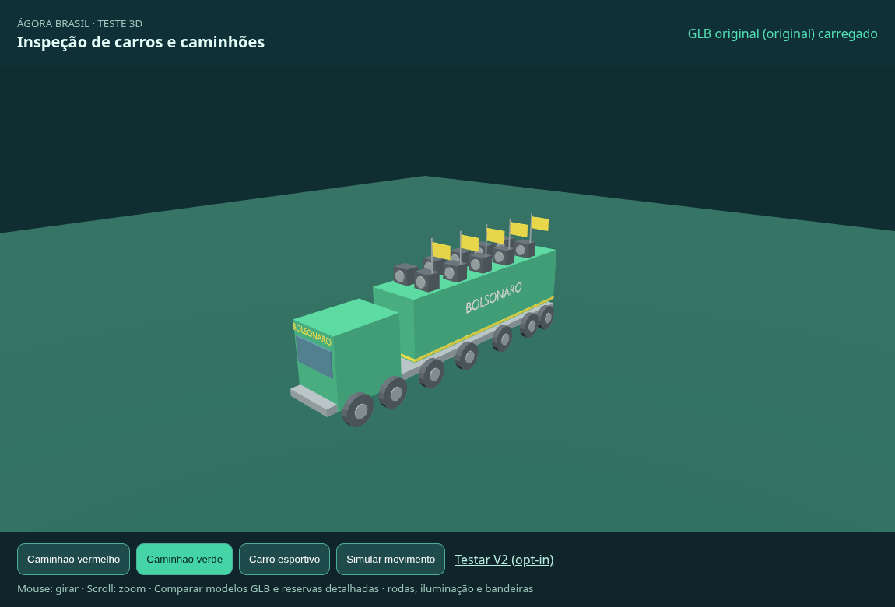
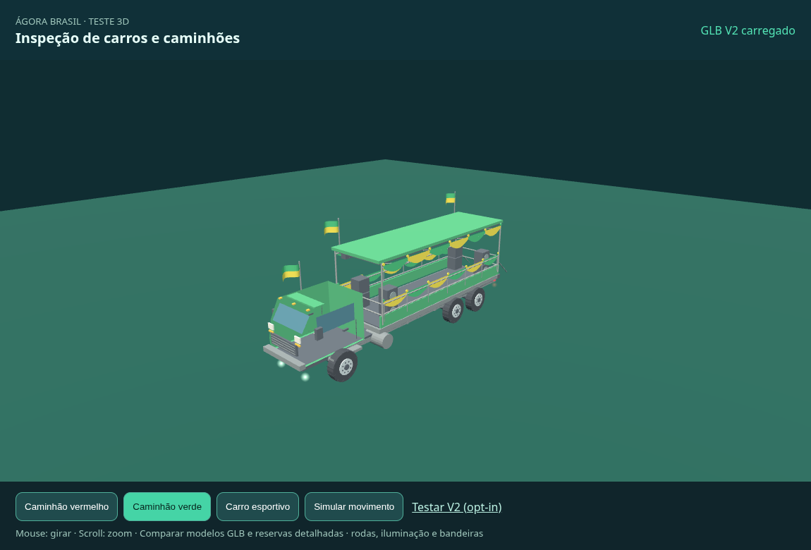
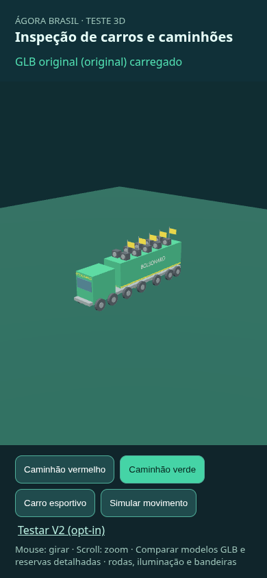
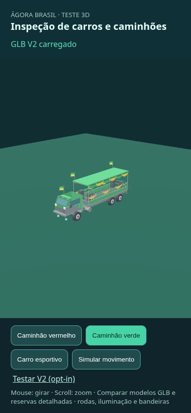
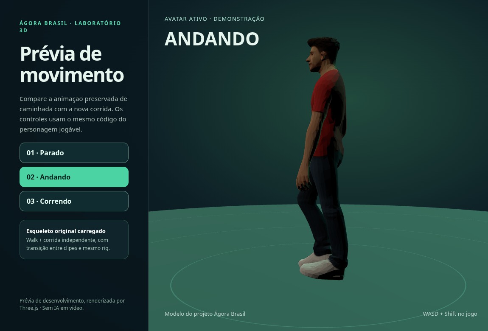
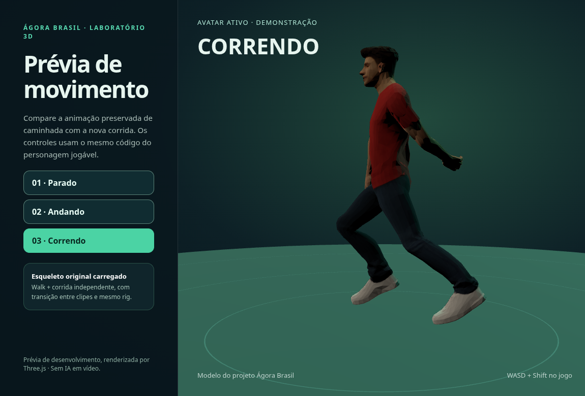

# Caminhões V2 — integração e QA real, 23/10/2026

**Decisão: aptos para prévia opt-in; NÃO aprovados para substituir os originais.**
O acabamento continua procedural, sem texturas fotográficas, e depende de aceite
visual. Performance, controles e colisões em iPhone/Safari físico não foram
homologados. Separadamente, o contato dos pés na corrida está reprovado nesta
prévia e impede aprovar o conjunto do PR para produção.

PR #13 permanece draft. Nenhum merge, deploy ou alteração na Square Cloud.
Branch: `fix/p0-veiculos-corrida-visual-20261023`.
Base do PR: `ee98e1cbccbfd4f7aa251d848d0db2bcac61a5e0`.
HEAD recebido: `cc242dc2ee6193d39dcdc144a7b2c73f8a4511d2`.
O SHA do commit desta continuação está registrado na descrição do PR.

## Capturas do Chromium, sem montagem/síntese

| Modelo | V1 | V2 |
| --- | --- | --- |
| Vermelho |  |  |
| Verde |  |  |
| Mobile emulado, verde |  |  |

Também há vistas `*-lateral.png`, cenas `*-movimento.png` e capturas mobile de
ambas as cores. URLs executadas, viewport, versão do navegador, dimensões,
materiais, raios, giros, deriva de rodas/haste e tempos de frame: [browser.json](browser.json).

## Arquivos e integração

| GLB V2 | Bytes | Triângulos | Meshes | Rodas | Bandeiras |
| --- | ---: | ---: | ---: | ---: | ---: |
| Vermelho | 221.764 | 12.144 | 17 | 4 | 3 |
| Verde | 223.896 | 13.496 | 20 | 6 | 3 |

- Binários copiados sem alteração; SHA-256 coincide com o manifesto do ZIP.
- GLB 2.0, buffer embutido, cores `COLOR_0`, nenhuma textura/URI externa.
- Khronos glTF Validator: **0 erros / 0 avisos** em ambos; 37/40 hints opcionais
  `BUFFER_VIEW_TARGET_MISSING`. Relatórios `*-validation.json` preservados.
- Eixos corretos: Y para cima, cabine/para-brisa na frente +Z. Comprimento em
  runtime: **17 m**, largura ~3,88 m, altura ~6,81 m. V1: 17 × 3,92 × 7,13 m.
- Rodas V2 isoladas, pivôs no eixo X, raio **0,767 m** após normalização;
  animação verificada em referencial da carroceria, excluindo suspensão.
- As três bandeiras giram ao redor da haste vertical Y, mantendo o tecido
  preso. A rotação X anterior afastava o tecido da haste.
- Pintura, borracha e tecido recebem metalness 0; aço/cromo 0,55. Os arquivos
  não exportam materiais PBR, cujo padrão metálico escurecia as peças.
- Prévia responsiva reenquadra câmera e mantém os modelos dentro do canvas.
- V2 só carrega em `/preview-caminhoes.html?trucksV2=1`; V1 continua por padrão
  e na página principal mesmo com esse parâmetro. Falha de V2 volta a V1 nas
  duas cores, comprovada por falha de rede induzida no navegador.
- Os hashes V1 seguem `17488ae3…f9fc1` (vermelho) e `8ff894ee…afaa4` (verde),
  iguais aos do HEAD recebido. Testes fixam os hashes completos.

Os nomes `.001` dos nós V1 são sanitizados pelo GLTFLoader para `001`; o
detector atual reconhece só uma roda e uma bandeira por V1. Isso é uma
limitação anterior, não ausência de peças no GLB. Os nomes V2 com `_` são
reconhecidos integralmente. Corrige-se aqui a descrição anterior do PR, que
inferia malhas agregadas a partir apenas dessa contagem no runtime.

## Caminhada e corrida: contato não aprovado




Walk e Run são clipes distintos: **4,20 s** e **1,00 s**, ambos timeScale 1.
A prévia deixou de acrescentar oscilação vertical artificial. A amostragem
usa a malha com skinning, 883/914 vértices influenciados por Foot/Toe de cada
lado, em 61 fases do ciclo; não usa só a posição do osso.

| Medição da sola mais baixa, relativa ao piso da prévia (-0,025 m) | Walk | Run |
| --- | ---: | ---: |
| Menor distância ao piso | -1,14 cm | +4,52 cm |
| Maior distância ao piso | +3,97 cm | +21,82 cm |
| Amostras a até 2 cm do piso | 52/61 | 0/61 |

A corrida tem flexão de pernas e passada distintas da caminhada, mas nenhuma
amostra confirmou apoio. A fase aérea é esperada em corrida; ausência de
apoio durante o ciclo inteiro é o bloqueio. Há penetração leve no Walk.
Não houve alteração de clipes/rig/velocidade do jogador nesta continuação.
Retarget/altura do quadril e sincronização da passada precisam de correção
própria antes de homologar contato e deslizamento dos pés no jogo.

## Regressão e reprodução

```sh
npm ci
npm install --no-save --package-lock=false puppeteer-core gltf-validator
npm test
npm run check
node --check server.js
node --check public/app.js
node --check public/preview-corrida.js
node --check scripts/qa-cdn-transport.mjs
node --check scripts/trucks-v2-browser-qa.mjs
node --check scripts/validate-trucks-v2.mjs
node scripts/validate-trucks-v2.mjs
CHROME_BIN=/usr/bin/chromium node scripts/ci-visual-smoke.mjs
CHROME_BIN=/usr/bin/chromium node scripts/ci-vehicle-run-smoke.mjs
CHROME_BIN=/usr/bin/chromium node scripts/trucks-v2-browser-qa.mjs
```

Neste executor, usar `QA_CDN_VIA_CURL=1` nos comandos de navegador: o Chromium
não herdou o transporte proxy/CA. O helper serve os módulos Three.js públicos
por curl, com TLS verificado, sem mudar bytes. Não modifica a aplicação nem
simula WebGL. O primeiro timeout direto está preservado em
`baseline-direct-browser-timeout.json`.

- **83/83 testes Node**, incluindo hashes, flag, servidor, salas, reconexão,
  veículos, visitante e combate: [node-tests.txt](node-tests.txt).
- Sintaxe: [syntax.txt](syntax.txt), mais checks dos novos arquivos acima.
- Smoke da cena principal: [game-smoke.txt](game-smoke.txt). Verificou canvas,
  entrada WebSocket, seletor de figurantes e cartaz. A mensagem legada do
  smoke sobre “6 modelos originais” não prova seis GLBs carregados: assets
  remotos fora da política do executor falharam e ativaram reservas.
- Smoke de veículos/Run: [vehicle-run-smoke.txt](vehicle-run-smoke.txt).
  V1 vermelho/verde locais; carro usou reserva procedural porque o CDN remoto
  estava inacessível. Homem e clipe Run locais, rigged=true, fallback=false.
- QA V2: [browser-run.txt](browser-run.txt). Zero erros JS não tratados nas
  prévias. Falhas de requests do CDN externo na cena principal e a falha V2
  induzida são registradas separadamente.
- O workflow existente de browser passa a executar a validação e comparação
  V2 e publicar os artefatos; não há etapa de deploy.

Os tempos de frame em `browser.json` são 40 intervalos de requestAnimationFrame
por cena após aquecimento, sob SwiftShader/CPU. Servem para comparação deste
runner; **não são FPS de iPhone**, benchmark de GPU real ou capacidade de
conexões multiplayer. Não foram executados testes de carga contra produção.
Contratos WebSocket, física/colisões, HUD do jogo e servidor não mudaram.
